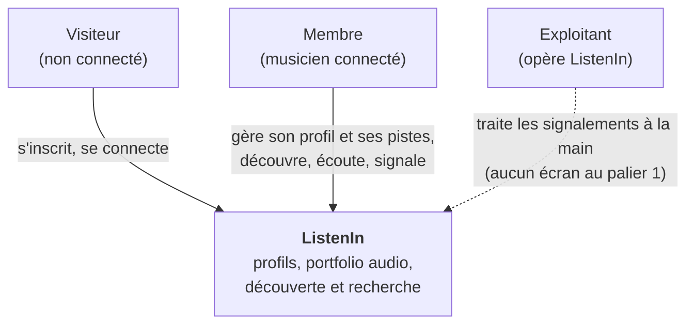
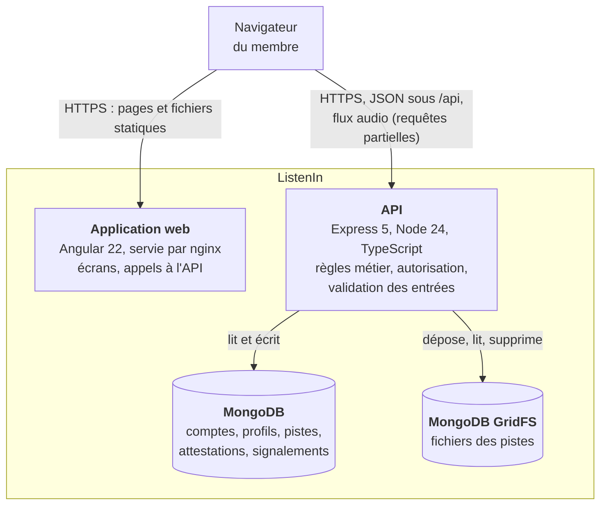

# Architecture

Vue d'ensemble du système, selon le modèle C4 : le **contexte** (niveau 1) puis les **conteneurs** (niveau 2). Les domaines sont décrits dans [DOMAIN.md](DOMAIN.md), les exigences de qualité dans [QUALITY.md](QUALITY.md), les choix dans [adr/](adr/).

## État actuel

```text
frontend/  Angular 22, application vide
backend/   Express 5 + TypeScript, route GET /api/health, configuration validée, journaux structurés
```

Aucune base de données, authentification ni stockage de fichiers n'est encore branché. La base est choisie (ADR 0005) ; elle sera branchée à la première tranche.

## Niveau 1 : contexte

Qui utilise ListenIn, et avec quoi il communique.



Au palier 1, ListenIn ne dépend d'**aucun système externe**. Le premier viendra avec le « mot de passe oublié » (un service d'envoi d'e-mails), point bloquant avant ouverture.

## Niveau 2 : conteneurs

Les unités qui se déploient ou stockent des données. La base de données et le stockage audio sont deux rôles d'une **même instance MongoDB** (ADR 0005).



| Conteneur | Rôle | Ne fait pas |
|---|---|---|
| **Application web** | Affiche les écrans, appelle l'API, gère l'état d'affichage avec les Signals | Ne protège aucune donnée : un contrôle côté frontend n'est qu'une aide à l'ergonomie |
| **API** | Seul point d'entrée vers les données ; applique la matrice d'autorisation ; sert le son d'une piste après avoir vérifié les droits | Ne sert pas les pages |
| **Base de données** (MongoDB) | Données des cinq domaines | N'est jamais exposée au navigateur |
| **Stockage audio** (GridFS, dans la même instance MongoDB) | Contenu des fichiers | N'est jamais exposé directement au navigateur (SEC-6) |

**Même origine.** En production, le navigateur voit l'application et l'API sous **une seule adresse** (`/` et `/api`), derrière un proxy inverse. Cela évite d'ouvrir l'API à d'autres origines (CORS) et simplifie la session. En développement, le serveur Angular joue ce rôle de proxy.

## À l'intérieur de l'API : un monolithe modulaire

L'API est **un seul** déployable, découpé en modules qui suivent les domaines de [DOMAIN.md](DOMAIN.md) : Identité, Profil, Portfolio, Découverte et recherche, Confiance. Chaque module possède ses routes, sa logique et ses données, et n'expose aux autres qu'une interface (MAI-3). Le découpage se fait **au fil des tranches**, sans refonte préalable.

Un schéma de niveau 3 (composants) ne sera dessiné que pour un module devenu complexe.

## Principes

- **Autorisation dans l'API**, testée ligne par ligne ([AUTHORIZATION.md](AUTHORIZATION.md)).
- **Entrées non fiables** : validation à la frontière HTTP.
- **Configuration par environnement**, validée au démarrage ; aucun secret dans le dépôt.
- **Observabilité** : journaux JSON, identifiant de requête, point de santé.
- **Contrat d'abord** : toute route est décrite dans le contrat OpenAPI (ADR 0003).

## « Pas maintenant »

Chaque complexité n'entre que si son déclencheur apparaît.

| Pas maintenant | On l'ajoute quand |
|---|---|
| File de tâches | un traitement audio en arrière-plan est nécessaire (transcodage, forme d'onde) |
| Moteur de recherche dédié | les index de la base ne suffisent plus (PERF-2, PERF-4) |
| Cache partagé | une mesure montre qu'une lecture répétée coûte trop cher |
| Microservices | un module doit se déployer ou passer à l'échelle seul |
| Infrastructure as code | on dépasse un environnement simple |
| Gestion d'état globale (NgRx) | les Signals ne suffisent plus à partager l'état |

## Décisions à venir

Avant la première tranche :

- **Authentification et session** : mécanisme de session, algorithme de hachage, limitation des tentatives, politique de mot de passe.
- **Fichiers audio** : formats acceptés, taille et durée maximales (le stockage est choisi : GridFS, ADR 0005).
