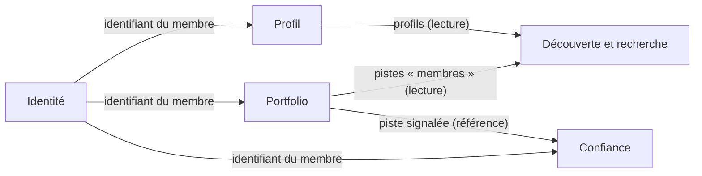

# Modèle de domaine

Les domaines du palier 1, leurs frontières et leur vocabulaire. Tiré de [PRODUCT.md](PRODUCT.md) et de [USER-STORIES.md](USER-STORIES.md) ; les règles d'accès sont dans [AUTHORIZATION.md](AUTHORIZATION.md).

## Les cinq domaines

| Domaine | Responsabilité | Possède | Stories |
|---|---|---|---|
| **Identité** | Comptes, connexion, session, acceptation des conditions d'utilisation | Compte, Acceptation des conditions | 1, 2 |
| **Profil** | Ce qu'un musicien dit de lui | Profil, Contact | 3, 4, 5 |
| **Portfolio** | Les morceaux d'un musicien et qui peut les entendre | Piste, Fichier audio, Crédit, Attestation | 6, 7, 8, 9 |
| **Découverte et recherche** | Trouver des musiciens et des pistes | rien : elle **lit** Profil et Portfolio | 10, 11, 12 |
| **Confiance** | Alerter sur un contenu | Signalement | 13 |

Chaque domaine est un **module** du backend (ADR 0001) : ses routes, sa logique et ses données. Un module ne modifie jamais les données d'un autre ; il passe par l'interface que l'autre expose.

## Carte des contextes

- **Identité** est en amont de tout : les autres domaines ne connaissent d'un membre que son **identifiant**, jamais son mot de passe ni sa session.
- **Découverte et recherche** est en lecture seule et ne voit **que** des pistes de visibilité *membres*. C'est Portfolio qui applique ce filtre, pas l'appelant.
- **Confiance** ne fait que référencer une piste ; elle ne la modifie ni ne la supprime.

## Glossaire

| Terme | Définition |
|---|---|
| **Visiteur** | Personne non connectée. Ne peut que s'inscrire ou se connecter. |
| **Membre** | Utilisateur connecté. |
| **Propriétaire** | Le membre qui a déposé une piste ou à qui appartient un profil. |
| **Exploitant** | Personne qui opère ListenIn (traitement manuel des signalements). Aucun écran au palier 1. |
| **Compte** | Identité de connexion : adresse e-mail et mot de passe. Un compte a exactement un profil. |
| **Profil** | Ce que le musicien publie sur lui : nom, instruments, genres, ville, présentation, contact. Visible de tous les membres. |
| **Contact** | Lien ou adresse e-mail optionnels, choisis par le musicien, visibles des membres seulement. |
| **Piste** | Un morceau déposé : titre, fichier audio, crédits, visibilité. Appartient à un seul membre. |
| **Fichier audio** | Le contenu sonore d'une piste. N'existe pas sans sa piste. |
| **Crédit** | Ce que le propriétaire a joué sur la piste (rôle ou instrument), plus un texte libre pour les autres musiciens. |
| **Visibilité** | *Privée* : propriétaire seulement. *Membres* : tous les membres. |
| **Attestation** | Déclaration, faite à chaque dépôt, que le déposant détient les droits ou une autorisation. Enregistrée et conservée. |
| **Signalement** | Alerte d'un membre sur une piste *membres*, avec un motif. |
| **Conditions d'utilisation** | Texte versionné accepté à l'inscription. |

## Invariants

Règles toujours vraies, à vérifier par des tests :

1. Une piste est **privée à sa création**.
2. Une piste appartient à **un et un seul** membre, pour toute sa vie.
3. Supprimer une piste supprime son **fichier audio**.
4. Aucune piste n'existe **sans attestation** enregistrée.
5. Un membre fait **au plus un signalement** par piste.
6. Le **contact** et les pistes ne sont jamais transmis à un visiteur.
7. Un compte n'est jamais créé **sans acceptation** enregistrée des conditions, avec sa date et sa version.
8. Une piste repassée en *privée* disparaît **aussitôt** de la découverte et de la recherche.
